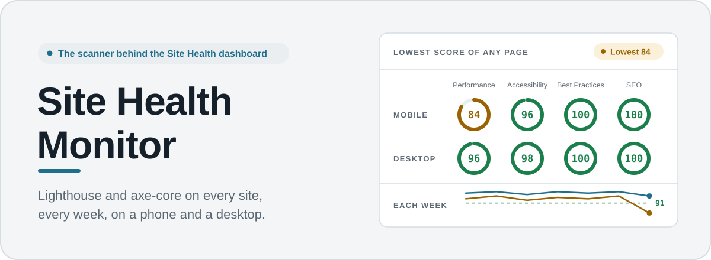
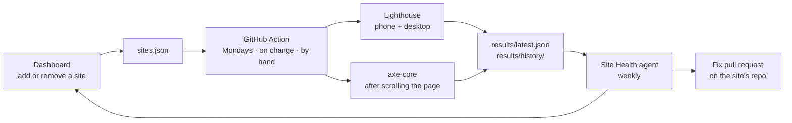

<p align="center">
  
</p>

<h1 align="center">Site Health Monitor</h1>

<p align="center"><b>A weekly health check for the websites I build and look after, with an AI agent that fixes what drops.</b></p>

<p align="center">
  
  
  
  
  
</p>

Every site is measured on a phone and on a desktop for Performance, Accessibility, Best
Practices and SEO. The target is every score between 91 and 100. When a site falls under it, an agent
reads the findings and opens a pull request on that site's repository, which I review and merge.

This repository is the scanner: the part that measures and records. The dashboard and the fixing
agent read what it writes.

## How it fits together



| Part | Where it lives | What it does |
|---|---|---|
| **Scanner** | this repo (`scan.mjs`, `.github/workflows/scan.yml`) | Measures every active site and commits the results |
| **Dashboard** | a hosted page with its own small database | Lists the sites, their scores, findings, history and the agent's runs; a site is added with its URL and, optionally, its GitHub repo |
| **Agent** | a scheduled AI agent, run weekly after the scan | Keeps `sites.json` in step with the dashboard, reads the results, and opens fix PRs that change neither behaviour nor appearance |

A site with a repository gets pull requests. A site without one (a hosted shop, for example) is
monitored only, and the agent lists the settings to change by hand.

## What a scan does

1. **Chooses the pages.** The home page first, then pages of the same host from `sitemap.xml`
   (following one level of sitemap index), up to the site's `maxPages`.
2. **Runs Lighthouse the way PageSpeed Insights does**, with simulated throttling, once as a phone
   and once as a desktop, for each page.
3. **Runs axe-core after scrolling the page from top to bottom.** Text inside reveal-on-scroll
   sections has opacity 0 when Lighthouse looks at it, so its accessibility score skips that text.
   Scrolling first brings every section in, and contrast and labelling problems that Lighthouse
   misses are found.
4. **Keeps the worst case.** A site's score per category is the lowest of any page checked, so one
   weak inner page cannot hide behind a fast home page.
5. **Records every audit below 0.9**, with the pages it failed on, so the agent starts from a list
   of concrete findings instead of a single number.
6. **Commits the results** to `results/latest.json`, and a dated copy to `results/history/`.

Two details that came from real sites:

- **Nothing is sent to a client's analytics or forms.** Requests to tag managers, analytics, ad
  pixels and form endpoints are stopped during the scrolled check.
- **Bot protection.** Some hosts answer a browser that calls itself headless with a "checking your
  browser" page, which would be measured instead of the site. The scrolled check asks as a normal
  browser.

## The results

`results/latest.json` is the contract between the scanner and the agent:

```
sites.{id}.{mobile|desktop}.scores    lowest score of any page checked, per category (0–100)
sites.{id}.{mobile|desktop}.metrics   the home page's lab metrics: LCP, FCP, TBT, CLS, Speed Index
sites.{id}.{mobile|desktop}.perPage   every page's scores and metrics
sites.{id}.{mobile|desktop}.issues    every audit below 0.9: id, title, category, score, value, pages
sites.{id}.{mobile|desktop}.axe       axe-core findings: rule, impact, node count, an example, pages
```

A page that cannot be measured is recorded with its error, and the other pages still count.

## Sites

`sites.json` holds the list. Each entry has an `id`, a `name`, the `url`, `maxPages` and `active`:

```json
{ "id": "onehublabs-com", "name": "onehub", "url": "https://onehublabs.com/", "maxPages": 5, "active": true }
```

The agent edits this file to match the dashboard, and a change to it starts a scan.

## When it runs

- **Every Monday at 04:00 UTC**, before the weekly agent run.
- **Whenever `sites.json` changes** on `main`.
- **By hand**, from the Actions tab.

Runs never overlap: a new one waits for the one in progress.

## Running it locally

Requirements: Node 22 and Chrome.

```bash
npm install
npm run scan               # every active site; writes results/
npm run scan -- <site id>  # one site, printed, nothing written
```

## Stack

Node 22 (ES modules) · Lighthouse 12 · axe-core 4 · puppeteer-core · chrome-launcher · GitHub Actions

## Author

Built by **Petros Pikionis**, AI Product Engineer.
[onehublabs.com](https://onehublabs.com) ·
[LinkedIn](https://www.linkedin.com/in/petros-platon-pikionis-4045a782/)
